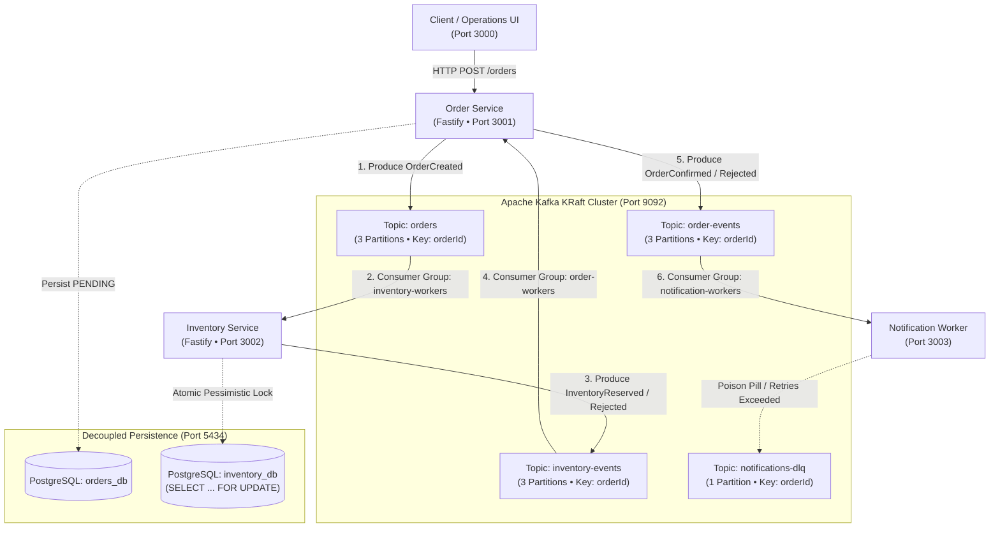

# Streamz ⚡ — Distributed Inventory & Order Choreography on Apache Kafka KRaft

<p align="center">
  
</p>

<p align="center">
  <a href="#quickstart-in-60-seconds"></a>
  <a href="https://kafka.apache.org/"></a>
  <a href="https://nodejs.org/">=_20.0.0-22c55e?style=flat-square&logo=node.js&logoColor=white" alt="Node Version" /></a>
  <a href="https://fastify.io/"></a>
  <a href="https://www.postgresql.org/"></a>
  <a href="./LICENSE"></a>
  <a href="http://localhost:3000/docs"></a>
</p>

---

**Streamz** is an enterprise-grade, distributed inventory management and order fulfillment engine built on **Apache Kafka KRaft**, **Fastify**, and **PostgreSQL**. It demonstrates production event-driven choreography, atomic row-level concurrency locking (`SELECT ... FOR UPDATE`), distributed sagas with compensating transactions, and dead-letter queues (DLQ).

**Built for production, engineered for learning.** State, databases, and message brokers run 100% locally on your machine via Docker Compose. Beyond operational capabilities, Streamz includes an interactive Nextra-styled operations console, a step-by-step event simulator, a live Murmur2 partition calculator, and a complete 7-module **Kafka Masterclass** documentation suite synthesized from official LinkedIn, Confluent, and IBM whitepapers.

---

## 📑 Table of Contents

- [Architecture & Event Choreography](#-architecture--event-choreography)
- [Key Features](#-key-features)
- [Interactive Explorer & Kafka Masterclass](#-interactive-explorer--kafka-masterclass)
- [Monorepo Package Layout](#-monorepo-package-layout)
- [Kafka Topic & Wire Event Contracts](#-kafka-topic--wire-event-contracts)
- [Quickstart in 60 Seconds](#-quickstart-in-60-seconds)
- [Verifying Event Lifecycles & Sagas](#-verifying-event-lifecycles--sagas)
- [Comprehensive Test Suite](#-comprehensive-test-suite)
- [REST API Reference](#-rest-api-reference)
- [License](#-license)

---

## 🏛️ Architecture & Event Choreography

Streamz enforces **database-per-service isolation**. The Order Service and Inventory Service own independent PostgreSQL schemas with zero cross-database queries or shared foreign keys. All inter-service state transitions propagate asynchronously through Apache Kafka KRaft.



---

## ⚡ Key Features

- **Apache Kafka KRaft Quorum Mode**: No ZooKeeper dependency. Uses modern KIP-500 Raft-based metadata consensus for sub-second controller failovers and lightweight resource consumption.
- **Zero Overselling via Pessimistic Row-Locks**: The Inventory Service executes `SELECT stock_quantity, reserved_quantity FROM products WHERE id = $1 FOR UPDATE` inside an ACID transaction. Concurrent checkouts for the same SKU block sequentially, guaranteeing zero race conditions or overselling.
- **Distributed Sagas & Compensating Transactions**: When an order requests more stock than available (e.g. 99 GPUs when only 2 exist), the system executes an automated compensating rollback:
  $$\text{OrderCreated} \longrightarrow \text{InventoryRejected} \longrightarrow \text{OrderRejected (Compensating)}$$
- **Deterministic Murmur2 Partition Routing**: Partitions all events on `orderId` using the 32-bit Murmur2 hashing algorithm matching Java/KafkaJS defaults. Guarantees strict chronological ordering for each order while parallelizing throughput across 3 partitions.
- **Idempotency & Deduplication**: Kafka producers configure `idempotent: true` with unique Producer IDs (PID) and monotonically increasing sequence numbers, eliminating duplicates from network retries.
- **Dead Letter Queue (DLQ)**: Malformed payloads, poison pills, and unrecoverable downstream worker errors are automatically redirected to `notifications-dlq` without stalling the primary event stream.

---

## 🎓 Interactive Explorer & Kafka Masterclass

Streamz is designed as a hands-on learning environment for distributed systems engineering:

### 1. Interactive Event Step Simulator
- **Step-by-Step Playback**: Walk through all 8 stages of event choreography: HTTP ingestion $\rightarrow$ Murmur2 hashing $\rightarrow$ Broker commit log append $\rightarrow$ Consumer polling $\rightarrow$ PostgreSQL atomic row-locking $\rightarrow$ Event propagation $\rightarrow$ Offset commit to `__consumer_offsets`.
- **Saga Out-of-Stock Simulation**: A one-click test case triggering an automatic compensating rollback to observe how distributed systems maintain consistency without two-phase commit (2PC).

### 2. Live Murmur2 Partition Calculator
- Interactive tool allowing you to enter any partition key (e.g. `ord-d9f7896f`, `customer-vip-42`) to compute the 32-bit Murmur2 hash in hex/decimal, bitwise positive transformation (`hash & 0x7fffffff`), and modulo target partition (`hash % 3`) with real-time visual shard highlighting.

### 3. Dedicated Dark Kafka Masterclass Portal (`/docs`)
- Accessible at `http://localhost:3000/docs`, modeled after TrackOpenSource’s sleek dark Nextra documentation suite.
- Contains **7 comprehensive modules** synthesized from official whitepapers:
  1. **Foundations & Commit Log** (LinkedIn architecture, sequential disk I/O, zero-copy `sendfile(2)`, Kafka vs RabbitMQ).
  2. **Topics & Storage Internals** (Segment files, `.log`, `.index`, `.timeindex`, Murmur2 hashing, compaction).
  3. **KRaft Quorum & High Availability** (ZooKeeper retirement, Raft metadata log, ISR, `min.insync.replicas`, High Watermark).
  4. **Producer Semantics & Exactly-Once (EOS)** (`acks=all`, idempotent PIDs, sequence numbers, batching with `linger.ms`).
  5. **Consumer Groups & Rebalances** (Range, RoundRobin, Cooperative Sticky Rebalance KIP-429, offset commits).
  6. **Enterprise Event-Driven Patterns** (Choreography vs Orchestration, Distributed Sagas, DLQs, Transactional Outbox).
  7. **Streamz Implementation Blueprint** (Fastify microservices, PostgreSQL row locks, and disaster recovery drills).

---

## 📦 Monorepo Package Layout

```
streamz/
├── assets/                          # README banners and architecture diagrams
├── docker-compose.yml               # Kafka KRaft (9092/9094) & PostgreSQL (5434)
├── packages/
│   ├── contracts/                   # Shared TypeScript interfaces & JSON schema envelopes
│   ├── dashboard-ui/                # Next.js 16 operations portal & dark /docs documentation
│   ├── inventory-service/           # Fastify service with PostgreSQL row-level locks
│   ├── kafka-client/                # Shared KafkaJS wrapper & Murmur2 partitioner
│   ├── notification-worker/         # Consumer worker with Dead Letter Queue handling
│   ├── observability-service/       # Health checks, lag telemetry & WebSocket exporter
│   └── order-service/               # Fastify REST API and idempotent Kafka producer
└── test/                            # E2E baseline, partitioning, chaos, and idempotency tests
```

---

## 📜 Kafka Topic & Wire Event Contracts

| Topic Name | Partitions | Key | Producer | Consumer Group | Cleanup | Payload Event |
|---|:---:|---|---|---|:---:|---|
| `orders` | 3 | `orderId` | Order Service | `inventory-workers` | `delete` | `OrderCreated` |
| `inventory-events` | 3 | `orderId` | Inventory Service | `order-workers` | `delete` | `InventoryReserved`, `InventoryRejected` |
| `order-events` | 3 | `orderId` | Order Service | `notification-workers` | `delete` | `OrderConfirmed`, `OrderRejected` |
| `notifications-dlq` | 1 | `orderId` | Notification Worker | `admin-audit` | `compact` | `NotificationFailed`, `PoisonPill` |

### Standard Wire Record Envelope
```json
{
  "eventId": "evt-7f8a92bc-01",
  "eventType": "OrderCreated",
  "eventVersion": 1,
  "aggregateId": "ord-d9f7896f",
  "correlationId": "req-4a81bc",
  "occurredAt": "2026-10-17T12:04:07.383Z",
  "payload": {
    "orderId": "ord-d9f7896f",
    "customerId": "cust-enterprise-01",
    "productId": "prod-monitor-4k",
    "quantity": 1,
    "unitPrice": 499.99
  }
}
```

---

## 🚀 Quickstart in 60 Seconds

### Prerequisites
- [Docker](https://docs.docker.com/get-docker/) & Docker Compose v2+
- [Node.js](https://nodejs.org/) v20.0.0 or higher
- npm v10+

### 1. Clone & Install Dependencies
```bash
git clone https://github.com/techmedaddy/streamz.git
cd streamz
npm install
```

### 2. Launch Infrastructure (Kafka KRaft & PostgreSQL)
```bash
npm run docker:up
```
*Verifies Kafka KRaft on port `9092` and PostgreSQL on port `5434`.*

### 3. Launch All Microservices & Dashboard
```bash
npm run dev
```

### 4. Open the Portals
- **Operations Console & Simulator**: [http://localhost:3000](http://localhost:3000)
- **Kafka Masterclass Documentation**: [http://localhost:3000/docs](http://localhost:3000/docs)
- **Order Service REST API**: [http://localhost:3001](http://localhost:3001)
- **Inventory Service REST API**: [http://localhost:3002](http://localhost:3002)

---

## 🧪 Verifying Event Lifecycles & Sagas

### Scenario A: Successful Checkout (Happy Path)
Dispatch an order for an available SKU:
```bash
curl -X POST http://localhost:3001/orders \
  -H "Content-Type: application/json" \
  -d '{
    "customerId": "cust-enterprise-01",
    "productId": "prod-monitor-4k",
    "quantity": 1,
    "unitPrice": 499.99
  }'
```
**Observed Result**:
1. Order Service responds with HTTP 201 (`status: PENDING`).
2. Order Service produces `OrderCreated` to topic `orders`.
3. Inventory Service acquires row-lock `SELECT ... FOR UPDATE`, increments `reserved_quantity`, and produces `InventoryReserved`.
4. Order Service transitions order status to `CONFIRMED` in under 450ms.

---

### Scenario B: Out-of-Stock Compensating Rollback (Saga)
Attempt to order 99 units of a limited item (e.g. GPU with only 2 units in stock):
```bash
curl -X POST http://localhost:3001/orders \
  -H "Content-Type: application/json" \
  -d '{
    "customerId": "cust-flash-buyer",
    "productId": "prod-limited-edition-gpu",
    "quantity": 99,
    "unitPrice": 899.99
  }'
```
**Observed Result**:
1. Order Service creates order as `PENDING`.
2. Inventory Service row-lock check detects insufficient stock and rolls back the local database transaction.
3. Inventory Service emits `InventoryRejected` (`rejection_reason: "Insufficient stock: requested 99, available 2"`).
4. Order Service consumes event, updates order to `REJECTED`, and preserves audit trail with zero lost stock.

---

## 🔬 Comprehensive Test Suite

Streamz includes a battle-tested test suite validating distributed guarantees:

```bash
# Run end-to-end choreography baseline
npm run test:e2e

# Verify Murmur2 partition distribution across 3 partitions
npm run test:partitioning

# Verify duplicate elimination with idempotent producer retries
npm run test:idempotency

# Verify Dead Letter Queue routing for poison pill payloads
npm run test:dlq

# Verify consumer lag calculation and metrics export
npm run test:lag
```

---

## 📡 REST API Reference

### Order Service (Port 3001)
- `POST /orders`: Place a new customer order.
  ```json
  { "customerId": "string", "productId": "string", "quantity": 1, "unitPrice": 99.99 }
  ```
- `GET /orders`: List all historical orders with fulfillment status.
- `GET /orders/:id`: Fetch order details by ID.

### Inventory Service (Port 3002)
- `GET /products`: List warehouse catalog with `stock_quantity`, `reserved_quantity`, and available units.
- `GET /products/:id`: Fetch individual SKU status.

---

## 📄 License

This project is licensed under the [MIT License](./LICENSE).

---

<p align="center">
  Built with ❤️ for distributed systems engineers and event-driven architecture learners.
</p>
