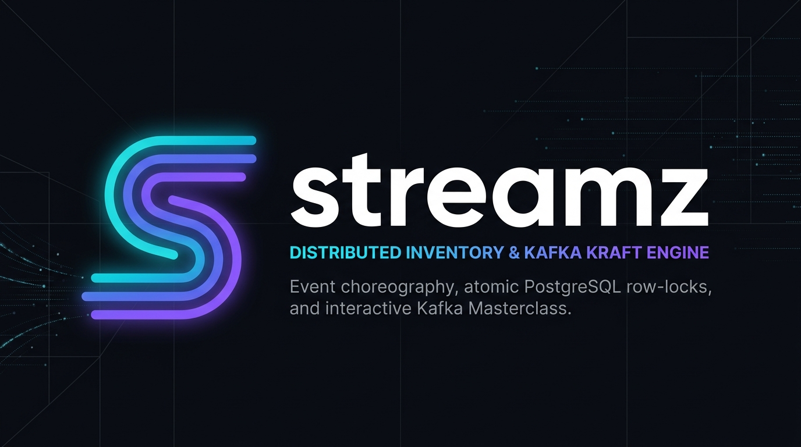
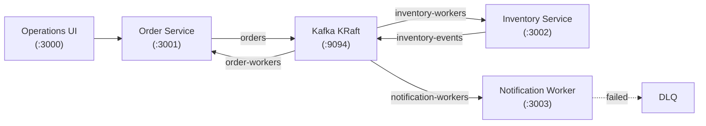

<p align="center">
  
</p>

<p align="center">
  <a href="https://github.com/techmedaddy/streamz"></a>
  <a href="https://kafka.apache.org/"></a>
  <a href="https://fastify.io/"></a>
  <a href="https://www.postgresql.org/"></a>
  <a href="./LICENSE"></a>
  <a href="http://localhost:3000/docs"></a>
</p>

# streamz

**streamz** is a distributed order and inventory choreography engine built on **Apache Kafka KRaft**, **Fastify**, and **PostgreSQL**.

Engineered for production and designed for learning, it demonstrates real-world event-driven patterns with zero external dependencies — running 100% locally with a built-in operations UI and an interactive Kafka Masterclass.

---

## ⚡ Quickstart

Get everything running in under 60 seconds:

```bash
# 1. Install dependencies
npm install

# 2. Start Kafka KRaft & PostgreSQL
npm run docker:up

# 3. Start services & dashboard UI
npm run dev
```

Open [http://localhost:3000](http://localhost:3000) for the operations console or [http://localhost:3000/docs](http://localhost:3000/docs) for the Kafka Masterclass documentation.

---

## 🚀 Features

- **Apache Kafka KRaft Mode** — Raft metadata consensus without ZooKeeper.
- **Zero Overselling** — Atomic row-level locks (`SELECT ... FOR UPDATE`) prevent inventory race conditions.
- **Distributed Sagas** — Automated compensating transactions on stock depletion.
- **Murmur2 Partitioning** — Consistent key-based message routing matching Kafka native standards.
- **Resilient Workers** — Idempotent producers, consumer group rebalancing, and Dead Letter Queues (DLQ).
- **Interactive Console & Docs** — Built-in event simulator, partition calculator, and Kafka masterclass.

---

## 🏛️ Architecture



---

## 🧪 Tests

```bash
# Run end-to-end choreography test
npm run test:e2e
```

---

## 📖 Documentation

Comprehensive guides, Kafka internals, and architecture blueprints are available in the dedicated documentation portal at [`/docs`](http://localhost:3000/docs).

---

## 📄 License

[MIT](./LICENSE)
